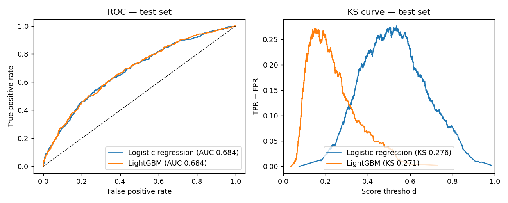
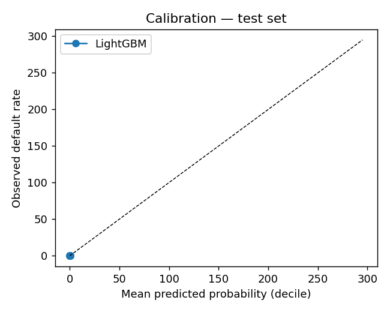
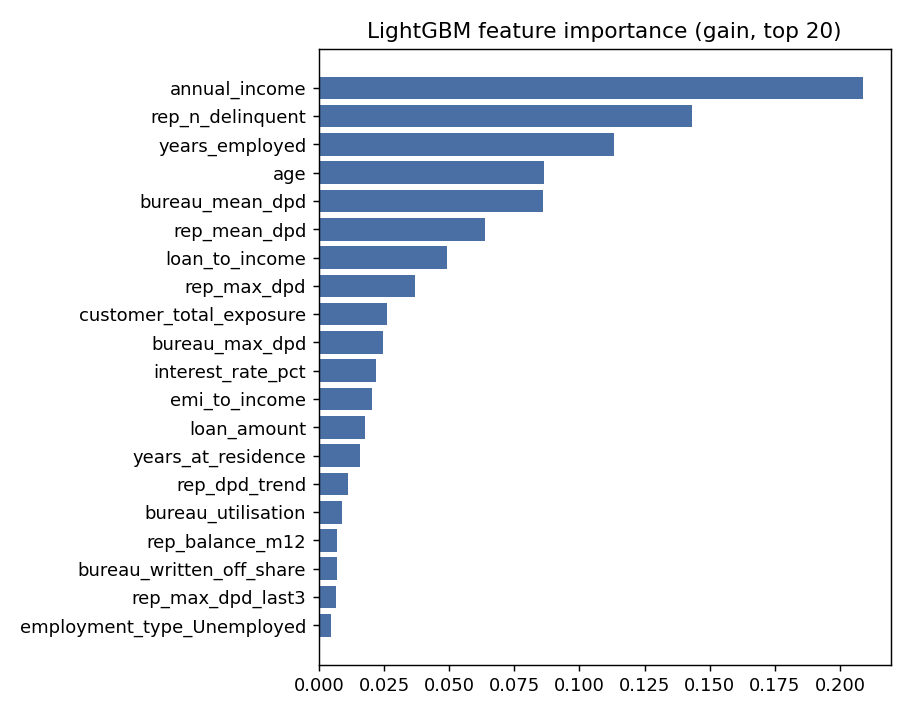
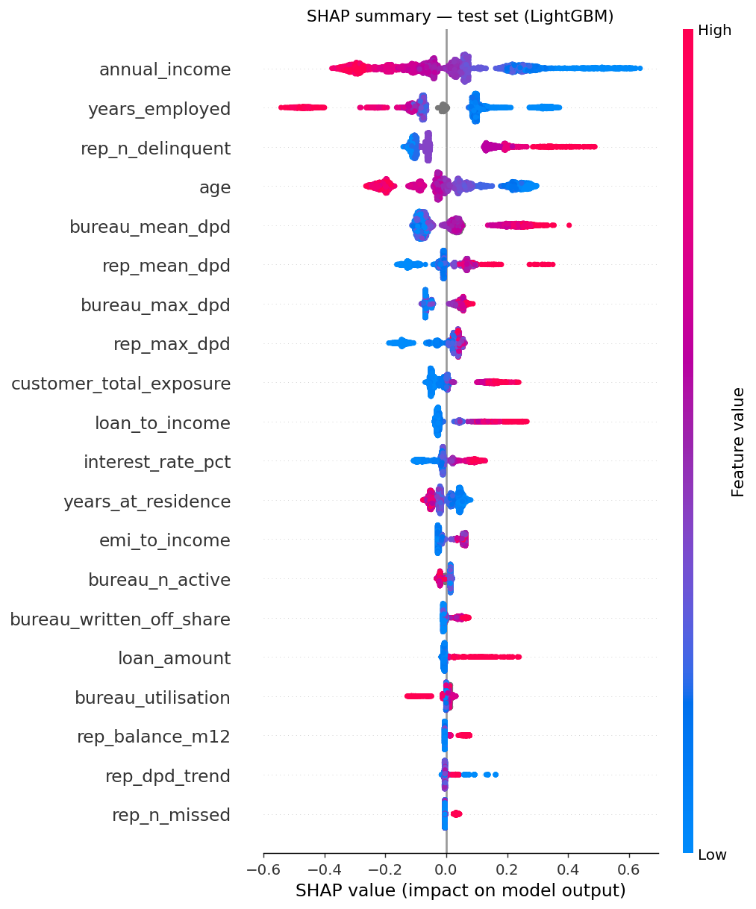

# Model Evaluation Report

Generated by `python -m src.modeling`. All metrics are computed on held-out data; nothing is hardcoded.

## Set-up

- **Grain / target:** one row per loan account; `target_default` as supplied (1 = defaulted).
- **Prediction point:** end of the 12-month observation window (behavioural scorecard). Inputs are application fields, customer profile, 12-month repayment aggregates and the bureau snapshot. Collections data and `gender` are excluded (see `reports/feature_dictionary.md` and assumptions A1-A4).
- **Split:** customers (not loans) are split 80/20 with a fixed seed, so a customer's loans are all in train or all in test. Train: 11,737 loans / 8,000 customers (default rate 16.12%); test: 2,948 loans / 2,000 customers (16.01%); customer overlap: 0.
- **Preprocessing:** median imputer + standard scaler + one-hot (logistic), one-hot only with native NaN handling (LightGBM). All fitted on the training fold only. Hyper-parameters chosen by 5-fold customer-grouped stratified CV on the training fold.
- **Class imbalance:** 16% positive rate. Logistic regression uses `class_weight='balanced'`; LightGBM is unweighted so that its probabilities stay close to calibrated for the dashboard (see calibration below). Both are evaluated on the untouched test fold.
- **Metric definitions:** ROC-AUC; **Gini = 2 × AUC − 1** (ROC-based definition); **KS** = max(TPR − FPR) across thresholds; Brier score as a calibration check.

## Model comparison (test set)

| Model | ROC-AUC | Gini | KS | Brier |
|---|---|---|---|---|
| Logistic regression (baseline) | 0.6842 | 0.3683 | 0.2763 | 0.2234 |
| LightGBM | 0.6840 | 0.3680 | 0.2710 | 0.1255 |

Training-fold metrics, for over-fit inspection:

| Model | ROC-AUC | Gini | KS | Brier |
|---|---|---|---|---|
| Logistic regression | 0.6936 | 0.3872 | 0.2918 | 0.2200 |
| LightGBM | 0.7103 | 0.4205 | 0.3163 | 0.1231 |

Out-of-time check — trained on 2018-2022 originations (12,215 loans), tested on the 2023 vintage (2,470 loans):

| Model | ROC-AUC | Gini | KS | Brier |
|---|---|---|---|---|
| Logistic regression | 0.6957 | 0.3914 | 0.3117 | 0.2206 |
| LightGBM | 0.6907 | 0.3813 | 0.2987 | 0.1199 |

### Cross-validation (training fold only)

Logistic C: 0.01: 0.6758, 0.1: 0.6722, 1.0: 0.6712 → selected C = 0.01.  
LightGBM: leaves=3,trees=150: 0.6742, leaves=3,trees=300: 0.6764, leaves=4,trees=150: 0.6756, leaves=4,trees=300: 0.6757, leaves=7,trees=150: 0.6751, leaves=7,trees=300: 0.6733, leaves=15,trees=150: 0.6729, leaves=15,trees=300: 0.6672 → selected leaves=3,trees=300.

## Threshold-dependent metrics (test set)

Risk segments are defined on the LightGBM score using training-set quantiles: **High** ≥ 0.278 (top 10% of training scores), **Medium** ≥ 0.180 (next 20%), else **Low**.

| Operating point | Threshold | Flagged | Precision | Recall | TP | FP | FN | TN |
|---|---|---|---|---|---|---|---|---|
| LightGBM — High cut-off | 0.278 | 10.2% | 36.4% | 23.3% | 110 | 192 | 362 | 2284 |
| LightGBM — Medium cut-off | 0.180 | 30.2% | 27.0% | 51.1% | 241 | 650 | 231 | 1826 |
| Logistic — top 10% of train scores | 0.675 | 10.2% | 35.8% | 22.9% | 108 | 194 | 364 | 2282 |
| Logistic — top 30% of train scores | 0.538 | 30.4% | 27.9% | 53.0% | 250 | 647 | 222 | 1829 |

Observed default rate by risk segment (test set):

| Segment | Loans | Default rate |
|---|---|---|
| Low | 2057 | 11.2% |
| Medium | 589 | 22.2% |
| High | 302 | 36.4% |

### Calibration (LightGBM, test deciles)

| Decile | Loans | Mean predicted | Observed |
|---|---|---|---|
| 0 | 295 | 0.066 | 0.061 |
| 1 | 295 | 0.086 | 0.061 |
| 2 | 295 | 0.100 | 0.088 |
| 3 | 294 | 0.112 | 0.122 |
| 4 | 295 | 0.125 | 0.122 |
| 5 | 295 | 0.143 | 0.146 |
| 6 | 294 | 0.167 | 0.187 |
| 7 | 295 | 0.198 | 0.186 |
| 8 | 295 | 0.247 | 0.271 |
| 9 | 295 | 0.371 | 0.356 |

## Sensitivity: what the engineered features add (LightGBM, same split)

| Feature set | ROC-AUC | Gini | KS |
|---|---|---|---|
| Full (application + bureau + repayment) | 0.6840 | 0.3680 | 0.2710 |
| application only | 0.6519 | 0.3037 | 0.2456 |
| no bureau | 0.6784 | 0.3568 | 0.2786 |
| no repayment | 0.6629 | 0.3259 | 0.2651 |
| time filtered bureau | 0.6828 | 0.3656 | 0.2720 |

The `time_filtered_bureau` row replaces the snapshot bureau features with ones computed only from lines opened before the loan's prediction point (assumption A3). The gap between it and the full model bounds how much of the bureau contribution could be attributable to information that post-dates the prediction point.

## Feature importance and SHAP (LightGBM)

Top features by gain share:

| Feature | Gain share |
|---|---|
| `annual_income` | 0.209 |
| `rep_n_delinquent` | 0.143 |
| `years_employed` | 0.113 |
| `age` | 0.086 |
| `bureau_mean_dpd` | 0.086 |
| `rep_mean_dpd` | 0.064 |
| `loan_to_income` | 0.049 |
| `rep_max_dpd` | 0.037 |
| `customer_total_exposure` | 0.026 |
| `bureau_max_dpd` | 0.025 |
| `interest_rate_pct` | 0.022 |
| `emi_to_income` | 0.020 |
| `loan_amount` | 0.018 |
| `years_at_residence` | 0.016 |
| `rep_dpd_trend` | 0.011 |

Top features by mean |SHAP| on the test set:

| Feature | Mean abs SHAP |
|---|---|
| `annual_income` | 0.1668 |
| `years_employed` | 0.1367 |
| `rep_n_delinquent` | 0.1246 |
| `age` | 0.1188 |
| `bureau_mean_dpd` | 0.0955 |
| `rep_mean_dpd` | 0.0601 |
| `bureau_max_dpd` | 0.0543 |
| `rep_max_dpd` | 0.0510 |
| `customer_total_exposure` | 0.0459 |
| `loan_to_income` | 0.0438 |
| `interest_rate_pct` | 0.0432 |
| `years_at_residence` | 0.0373 |
| `emi_to_income` | 0.0306 |
| `bureau_n_active` | 0.0151 |
| `bureau_written_off_share` | 0.0134 |

Per-loan SHAP values for every account are stored in `data/processed/shap_values.parquet` and drive the account-level 'key drivers' in the dashboard. Logistic regression coefficients (standardised) are in `reports/tables/logistic_coefficients.csv`; the five largest are: `annual_income` -0.23, `years_employed` -0.18, `employment_type_Unemployed` +0.17, `age` -0.17, `bureau_mean_dpd` +0.13.

## Fairness / disparity check (test set, LightGBM)

`gender` is not a model input; `age` is (it carries signal, but it is a protected characteristic in many jurisdictions — flagged for the compliance team, assumption A9). The table reports observed vs predicted default and the share flagged High per group.

**gender**

| Group | Loans | Observed default | Mean PD | High-risk share | AUC within group |
|---|---|---|---|---|---|
| Female | 1266 | 15.6% | 0.159 | 9.3% | 0.689 |
| Male | 1682 | 16.3% | 0.164 | 10.9% | 0.679 |

**age_band**

| Group | Loans | Observed default | Mean PD | High-risk share | AUC within group |
|---|---|---|---|---|---|
| 21-30 | 766 | 18.8% | 0.208 | 19.8% | 0.657 |
| 31-40 | 1019 | 16.6% | 0.160 | 8.7% | 0.693 |
| 41-50 | 831 | 14.6% | 0.138 | 5.5% | 0.662 |
| 51-60 | 292 | 12.3% | 0.121 | 5.1% | 0.720 |
| 61+ | 40 | 5.0% | 0.100 | 0.0% | 0.697 |

## Model selection recommendation

_See the narrative in `reports/model_evaluation_notes.md`, written after reviewing these numbers._

## Post-deployment monitoring (proposed — not implemented here)

Once live, the score should be monitored monthly. **PSI** on the predicted-PD distribution (training population vs the latest scored month, 10 score bins) and **CSI** on each input feature's distribution (same bins) detect population drift; PSI/CSI below 0.10 is stable, 0.10-0.25 warrants investigation, above 0.25 triggers escalation to the model-risk team. Input-distribution checks should include missing-value rates (a jump in `interest_rate_pct_missing` or in customers with no bureau file would signal an upstream feed problem). When outcomes mature — here, once each loan's post-window default status is known — observed default rate by score decile, AUC, KS and Gini are recomputed quarterly and compared with the test-set benchmarks (AUC 0.684, KS 0.271); a drop of more than 0.05 AUC or a decile ranking inversion is an alert. Retraining is proposed annually, or earlier if PSI > 0.25, AUC falls below the alert level, or a material product/policy change occurs. Any retrained model goes through the same held-out and out-of-time validation, a fairness check, independent model-validation sign-off and a documented rollback plan (previous model kept deployable) before it replaces the production scorer. **In this assignment** only the one-off validation above exists; no monitoring job is implemented because there is no post-deployment data to monitor.