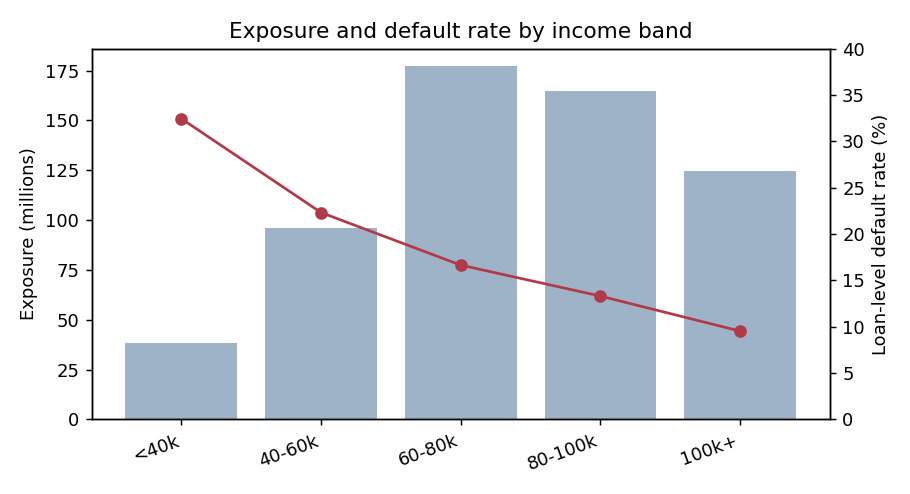
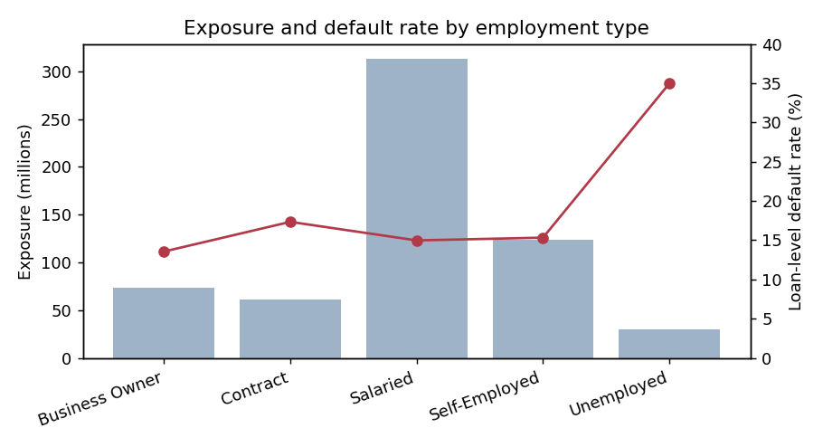
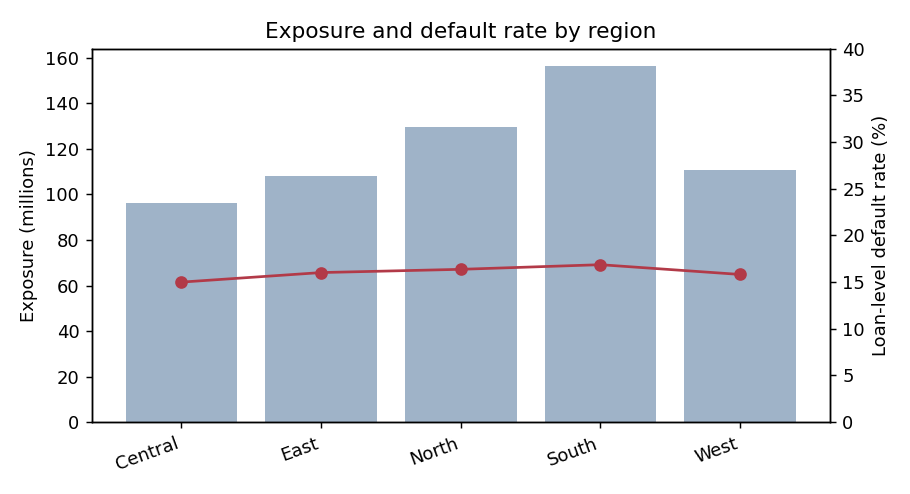
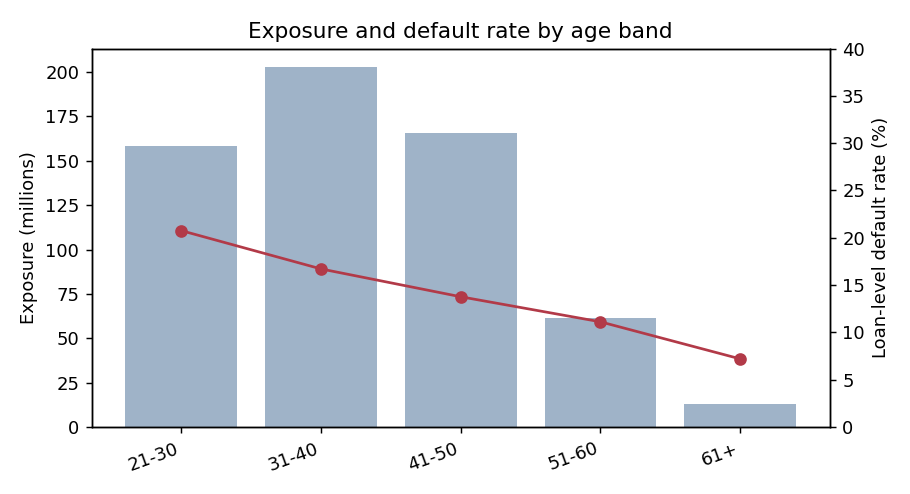
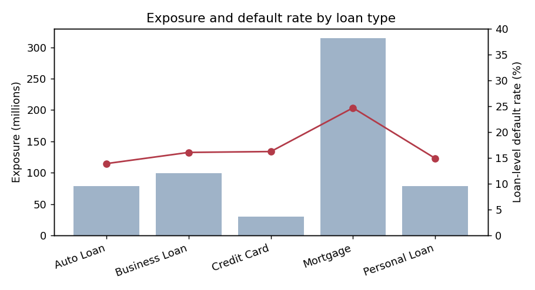
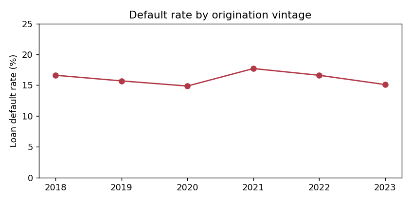
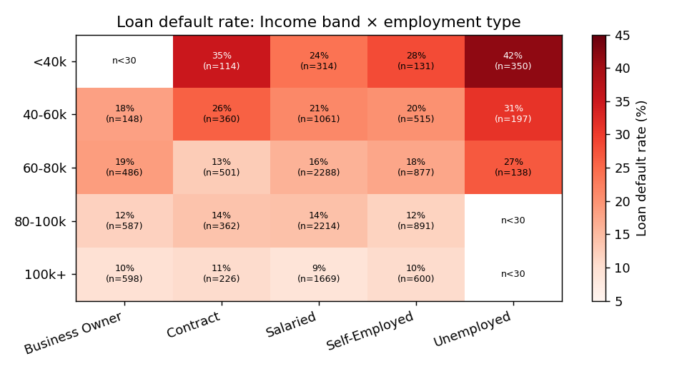
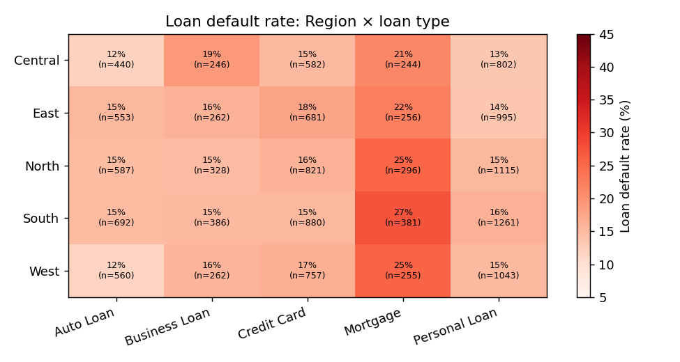
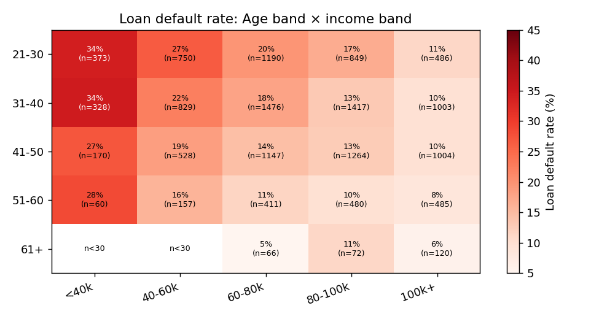

# Portfolio Findings

Generated by `python -m src.analytics`. Every figure below is computed from `data/processed/loan_level_dataset.parquet`.

## Definitions

- **Loan-level default rate** = defaulted loans ÷ loans in the segment (primary rate used throughout).
- **Customer-level default rate** = customers with at least one defaulted loan ÷ customers in the segment.
- **Exposure** = sum of `loan_amount` (originated amount; see assumption A6). **Exposure-weighted default rate** = exposure of defaulted loans ÷ exposure of the segment.
- Cross-cut cells with fewer than 30 loans are masked (shown as n<30) and are not used as evidence.

## Portfolio overview

- 14,685 loan accounts held by 10,000 customers; total originated exposure 601.1m.
- Loan-level default rate 16.1%; customer-level 21.6% (higher because 39% of customers hold 2-3 loans and a customer counts as defaulted if any loan did).
- Defaulted loans carry 21.1% of exposure — above the loan-count rate, because the largest product (mortgages) also defaults most often.

## Profiles by dimension

### Income Band

| income_band   |   loans |   customers |   exposure_m |   avg_loan_amount |   defaulted_loans |   defaulted_exposure |   exposure_share_% |   loan_default_rate_% |   exp_weighted_default_rate_% |   customer_default_rate_% |
|:--------------|--------:|------------:|-------------:|------------------:|------------------:|---------------------:|-------------------:|----------------------:|------------------------------:|--------------------------:|
| <40k          |     934 |         640 |         38.3 |             41038 |               303 |          1.58091e+07 |                6.4 |                  32.4 |                          41.2 |                      40   |
| 40-60k        |    2281 |        1556 |         96.2 |             42162 |               509 |          2.69874e+07 |               16   |                  22.3 |                          28.1 |                      29.5 |
| 60-80k        |    4290 |        2899 |        177.2 |             41305 |               714 |          3.95364e+07 |               29.5 |                  16.6 |                          22.3 |                      22.5 |
| 80-100k       |    4082 |        2778 |        165   |             40411 |               543 |          2.86231e+07 |               27.4 |                  13.3 |                          17.4 |                      18.4 |
| 100k+         |    3098 |        2127 |        124.5 |             40176 |               295 |          1.59631e+07 |               20.7 |                   9.5 |                          12.8 |                      13.1 |

### Employment Type

| employment_type   |   loans |   customers |   exposure_m |   avg_loan_amount |   defaulted_loans |   defaulted_exposure |   exposure_share_% |   loan_default_rate_% |   exp_weighted_default_rate_% |   customer_default_rate_% |
|:------------------|--------:|------------:|-------------:|------------------:|------------------:|---------------------:|-------------------:|----------------------:|------------------------------:|--------------------------:|
| Business Owner    |    1844 |        1244 |         73.5 |             39865 |               250 |          1.38755e+07 |               12.2 |                  13.6 |                          18.9 |                      18.9 |
| Contract          |    1563 |        1076 |         61.6 |             39406 |               271 |          1.40133e+07 |               10.2 |                  17.3 |                          22.8 |                      22.7 |
| Salaried          |    7546 |        5149 |        313   |             41481 |              1130 |          6.17869e+07 |               52.1 |                  15   |                          19.7 |                      20.4 |
| Self-Employed     |    3014 |        2037 |        123.4 |             40933 |               462 |          2.35741e+07 |               20.5 |                  15.3 |                          19.1 |                      20.4 |
| Unemployed        |     718 |         494 |         29.6 |             41261 |               251 |          1.36692e+07 |                4.9 |                  35   |                          46.1 |                      43.1 |

### Region

| region   |   loans |   customers |   exposure_m |   avg_loan_amount |   defaulted_loans |   defaulted_exposure |   exposure_share_% |   loan_default_rate_% |   exp_weighted_default_rate_% |   customer_default_rate_% |
|:---------|--------:|------------:|-------------:|------------------:|------------------:|---------------------:|-------------------:|----------------------:|------------------------------:|--------------------------:|
| Central  |    2314 |        1579 |         96.3 |             41621 |               347 |          1.84267e+07 |               16   |                  15   |                          19.1 |                      20.5 |
| East     |    2747 |        1908 |        108.2 |             39391 |               440 |          2.17791e+07 |               18   |                  16   |                          20.1 |                      21.2 |
| North    |    3147 |        2115 |        129.4 |             41129 |               515 |          2.77835e+07 |               21.5 |                  16.4 |                          21.5 |                      21.6 |
| South    |    3600 |        2420 |        156.3 |             43408 |               607 |          3.57198e+07 |               26   |                  16.9 |                          22.9 |                      23   |
| West     |    2877 |        1978 |        110.9 |             38548 |               455 |          2.32099e+07 |               18.4 |                  15.8 |                          20.9 |                      21.1 |

### Age Band

| age_band   |   loans |   customers |   exposure_m |   avg_loan_amount |   defaulted_loans |   defaulted_exposure |   exposure_share_% |   loan_default_rate_% |   exp_weighted_default_rate_% |   customer_default_rate_% |
|:-----------|--------:|------------:|-------------:|------------------:|------------------:|---------------------:|-------------------:|----------------------:|------------------------------:|--------------------------:|
| 21-30      |    3648 |        2485 |        158.2 |             43372 |               757 |          4.1867e+07  |               26.3 |                  20.8 |                          26.5 |                      27.6 |
| 31-40      |    5053 |        3459 |        203.1 |             40200 |               844 |          4.60933e+07 |               33.8 |                  16.7 |                          22.7 |                      22.2 |
| 41-50      |    4113 |        2794 |        165.6 |             40273 |               566 |          2.86114e+07 |               27.6 |                  13.8 |                          17.3 |                      18.6 |
| 51-60      |    1593 |        1062 |         61.4 |             38517 |               177 |          8.78861e+06 |               10.2 |                  11.1 |                          14.3 |                      15.7 |
| 61+        |     278 |         200 |         12.8 |             45921 |                20 |          1.55876e+06 |                2.1 |                   7.2 |                          12.2 |                      10   |

### Loan Type

| loan_type     |   loans |   customers |   exposure_m |   avg_loan_amount |   defaulted_loans |   defaulted_exposure |   exposure_share_% |   loan_default_rate_% |   exp_weighted_default_rate_% |   customer_default_rate_% |
|:--------------|--------:|------------:|-------------:|------------------:|------------------:|---------------------:|-------------------:|----------------------:|------------------------------:|--------------------------:|
| Auto Loan     |    2832 |        2626 |         78.8 |             27823 |               393 |          1.10882e+07 |               13.1 |                  13.9 |                          14.1 |                      14.7 |
| Business Loan |    1484 |        1431 |         99   |             66723 |               238 |          1.64298e+07 |               16.5 |                  16   |                          16.6 |                      16.6 |
| Credit Card   |    3721 |        3388 |         30   |              8067 |               603 |          4.82412e+06 |                5   |                  16.2 |                          16.1 |                      17.4 |
| Mortgage      |    1432 |        1387 |        314.5 |            219605 |               353 |          8.25555e+07 |               52.3 |                  24.7 |                          26.3 |                      25.2 |
| Personal Loan |    5216 |        4563 |         78.8 |             15110 |               777 |          1.20215e+07 |               13.1 |                  14.9 |                          15.3 |                      16.5 |

## Trend over time (origination vintage)

The only dates that support a trend are loan origination dates (2018-2023). Bureau and collections dates are not aligned to originations and the repayment history is indexed by month-since-origination, not calendar month, so no calendar-time delinquency trend can be built.

|   origination_year |   loans |   exposure |   loan_default_rate |
|-------------------:|--------:|-----------:|--------------------:|
|               2018 |    2487 |      100.5 |                16.6 |
|               2019 |    2434 |       98   |                15.7 |
|               2020 |    2396 |       99.3 |                14.9 |
|               2021 |    2447 |      104   |                17.7 |
|               2022 |    2451 |       98.6 |                16.6 |
|               2023 |    2470 |      100.8 |                15.1 |

Vintage default rates move between 14.9% and 17.7% with no directional trend; 2021 is the weakest vintage. Quarterly rates are noisier (≈600 loans per quarter) and are shown in the dashboard.

## Cross-dimensional cuts

### Income band × employment type

| income_band   |   Business Owner |   Contract |   Salaried |   Self-Employed |   Unemployed |
|:--------------|-----------------:|-----------:|-----------:|----------------:|-------------:|
| <40k          |            nan   |       35.1 |       23.9 |            28.2 |         41.7 |
| 40-60k        |             18.2 |       25.8 |       21.2 |            20   |         31   |
| 60-80k        |             18.7 |       12.8 |       16.1 |            17.6 |         26.8 |
| 80-100k       |             11.9 |       13.8 |       14.1 |            11.8 |        nan   |
| 100k+         |              9.5 |       10.6 |        9   |            10.5 |        nan   |

Loan counts per cell:

| income_band   |   Business Owner |   Contract |   Salaried |   Self-Employed |   Unemployed |
|:--------------|-----------------:|-----------:|-----------:|----------------:|-------------:|
| <40k          |               25 |        114 |        314 |             131 |          350 |
| 40-60k        |              148 |        360 |       1061 |             515 |          197 |
| 60-80k        |              486 |        501 |       2288 |             877 |          138 |
| 80-100k       |              587 |        362 |       2214 |             891 |           28 |
| 100k+         |              598 |        226 |       1669 |             600 |            5 |

### Region × loan type

| region   |   Auto Loan |   Business Loan |   Credit Card |   Mortgage |   Personal Loan |
|:---------|------------:|----------------:|--------------:|-----------:|----------------:|
| Central  |        11.8 |            19.1 |          15.3 |       21.3 |            13.3 |
| East     |        15.4 |            16   |          17.8 |       22.3 |            13.6 |
| North    |        14.8 |            14.9 |          16.1 |       25.3 |            15.4 |
| South    |        15   |            15.3 |          15.5 |       27.3 |            16.2 |
| West     |        11.6 |            15.6 |          16.5 |       25.5 |            15.2 |

Loan counts per cell:

| region   |   Auto Loan |   Business Loan |   Credit Card |   Mortgage |   Personal Loan |
|:---------|------------:|----------------:|--------------:|-----------:|----------------:|
| Central  |         440 |             246 |           582 |        244 |             802 |
| East     |         553 |             262 |           681 |        256 |             995 |
| North    |         587 |             328 |           821 |        296 |            1115 |
| South    |         692 |             386 |           880 |        381 |            1261 |
| West     |         560 |             262 |           757 |        255 |            1043 |

### Age band × income band

| age_band   |   <40k |   40-60k |   60-80k |   80-100k |   100k+ |
|:-----------|-------:|---------:|---------:|----------:|--------:|
| 21-30      |   34   |     26.5 |     19.7 |      16.8 |    11.1 |
| 31-40      |   34.5 |     22.3 |     17.9 |      13.1 |     9.7 |
| 41-50      |   27.1 |     18.6 |     14.5 |      12.7 |     9.6 |
| 51-60      |   28.3 |     15.9 |     11.4 |       9.8 |     8.5 |
| 61+        |  nan   |    nan   |      4.5 |      11.1 |     5.8 |

Loan counts per cell:

| age_band   |   <40k |   40-60k |   60-80k |   80-100k |   100k+ |
|:-----------|-------:|---------:|---------:|----------:|--------:|
| 21-30      |    373 |      750 |     1190 |       849 |     486 |
| 31-40      |    328 |      829 |     1476 |      1417 |    1003 |
| 41-50      |    170 |      528 |     1147 |      1264 |    1004 |
| 51-60      |     60 |      157 |      411 |       480 |     485 |
| 61+        |      3 |       17 |       66 |        72 |     120 |

## Insights

### 1. Mortgages are half the book's exposure and its highest-default product

Mortgages are 9.8% of loan accounts but 52.3% of exposure (1,432 loans). Their loan-level default rate is 24.7% against 15.2% for all other products combined, and 26.3% of mortgage exposure sits in defaulted loans. The pattern is steepest at low incomes: mortgage borrowers earning under 60k default at 35.1% (n=316, 71m exposure); under 40k the rate is 48.8% but on only 86 loans, so treat that cell as indicative.

**So what:** the portfolio's largest exposure concentration is also its worst-performing one. Collateral limits the loss given default, but a one-in-four default frequency on the biggest tickets dominates expected loss. **Action:** review mortgage affordability criteria (income floors, loan-to-income caps) and consider tighter limits or pricing for sub-60k income mortgage applicants; monitor mortgage exposure share as a concentration metric.

### 2. Default risk falls steadily with income; the lowest band defaults 3.4× as often as the highest

Borrowers earning under 40k are 6.4% of exposure (934 loans) yet 12.5% of defaulted exposure; their default rate is 32.4% versus 9.5% for the 100k+ band (3,098 loans). The gradient is monotonic across all five bands. Affordability explains part of it: the top loan-to-income quintile (LTI > 0.63) defaults at 23.8% against 13.2% for the bottom quintile.

**So what:** income and leverage are the strongest application-stage signals in the data and the low-income band is over-represented in losses relative to its size. **Action:** introduce or tighten loan-to-income limits for sub-60k applicants and route them to enhanced income verification; price the gradient explicitly rather than cross-subsidising.

### 3. 'Unemployed' borrowers default at more than twice the portfolio rate

718 loans (494 customers, 4.9% of exposure) belong to customers recorded as Unemployed. Their loan-level default rate is 35.0% vs 15.1% for everyone else; at customer level 43.1% of unemployed customers have a defaulted loan vs 20.5%. The segment contributes 10.8% of defaulted exposure — more than double its share of the book. Within the income × employment cut, Unemployed is the worst column in every income band where the cell has 30+ loans.

**So what:** a small, clearly identifiable segment carries disproportionate loss. Note every Unemployed customer reports positive income (median ≈ 41k), which is undefined in the data dictionary (open question Q2). **Action:** confirm what 'income' means for this group, require documented income sources, and consider a policy rule (decline or secured-only) rather than relying on the model alone.

### 4. Prior bureau write-offs and thin files identify elevated risk before any repayment is observed

Loans to customers with two or more written-off bureau lines (763 loans) default at 23.2%, against 14.6% with none (8,944 loans) and 17.7% with exactly one. Customers with no bureau file at all (1,462 loans) default at 17.6%, i.e. a thin file is riskier than a clean file. External delinquency adds to this: loans whose customer has a bureau line 30-60 days past due default at 20.6% vs 13.3% when max bureau DPD is ≤ 30.

**So what:** bureau history is usable at application time and separates risk without waiting for internal repayment behaviour. **Action:** add a 'two or more write-offs' hard stop or manual-review rule and treat no-bureau-file applicants as a distinct policy segment (e.g. lower initial limits).

### 5. Borrowers aged 21-30 are a quarter of exposure and default at almost three times the rate of over-60s

The 21-30 band is 3,648 loans and 26.3% of exposure, with a default rate of 20.8% vs 13.8% for 41-50 and 7.2% for 61+ (278 loans). Age interacts with income: young borrowers under 40k default at 34.0% (n=373) while young borrowers over 100k default at 11.1% (n=486) — the age effect is mostly an income-and-leverage effect.

**So what:** young borrowers are a growth segment but their loss rate is concentrated where income is also low. **Action:** segment limits by age × income rather than age alone (avoiding a blunt age rule that would raise fairness concerns) and target early-engagement collections for young, low-income accounts.

### What did *not* show up

- Region is flat: loan-level default rates range only from 15.0% to 16.9%. The only regional pattern is in mortgages (South 27.3% vs Central 21.3%), and the regional mortgage cells are 170-390 loans, so this is suggestive rather than conclusive.
- Disbursal channel and city tier show differences of under two percentage points.
- The number of loans a customer holds (1-3) barely moves the default rate (15.7% → 16.8%).